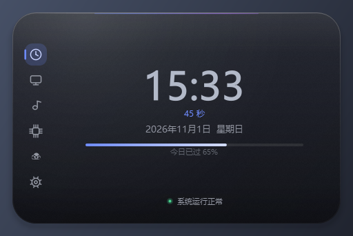
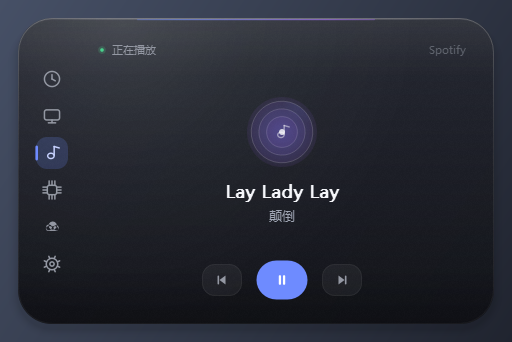
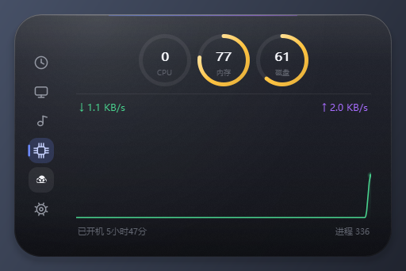
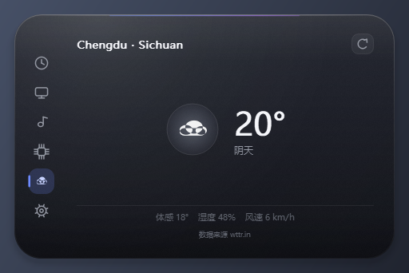
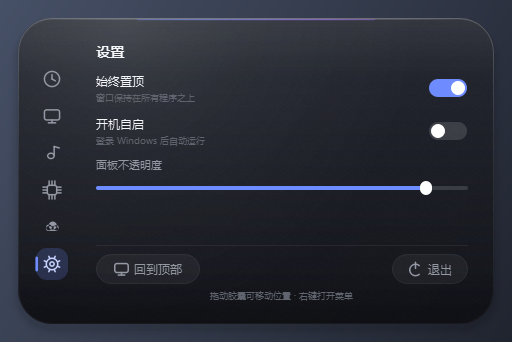

# DynamicIsland · Windows 灵动岛

一个仿 iPhone 灵动岛的 Windows 桌面小组件：屏幕顶部一枚可变形胶囊，
鼠标移上去就展开成**信息面板**，移开自动收回。

定位是**信息展示**——你正在做什么、在听什么、机器状态如何，一眼可见。
纯 Python + PyQt5 手绘实现，零图片素材。


## 展示什么

| 面板 | 内容 |
|------|------|
| 🕐 时钟 | 大字号时间、秒数、日期星期、今日进度条、系统负载呼吸点 |
| 🖥 工作状态 | **当前前台窗口**（应用徽章 + 中文应用名 + 窗口标题）、专注计时圆环、今日累计专注时长 |
| 🎵 正在播放 | **实时读取当前音乐**：歌名、歌手、播放器名称、播放/暂停状态；配套上一首/播放/下一首 |
| 📊 系统状态 | CPU / 内存 / 磁盘三环、实时上下行网速、滚动网速曲线、开机时长与进程数 |
| ☁ 天气 | 成都实时天气：温度、中文天气描述、体感、湿度、风速（wttr.in，无需 Key） |
| ⚙ 设置 | 始终置顶、开机自启、面板不透明度、重新定位、退出 |

### 信息是怎么读到的

- **正在播放**：先用音频会话（`pycaw`）找出真正在输出声音的进程，
  再枚举该进程的可见窗口标题解析出「歌名 - 歌手」。
  兼容 Spotify / 网易云 / QQ音乐 / 浏览器，不需要 winsdk。
  没声音在放时判定为「已暂停」。
- **工作状态**：`GetForegroundWindow` + `QueryFullProcessImageNameW`
  获取前台进程与窗口标题，进程名映射为中文（explorer → 资源管理器）。
- **系统状态**：`psutil` 取 CPU/内存/网速；磁盘因 psutil 在 Python 3.13 有
  bug，改用 `GetDiskFreeSpaceExW` 直读。

紧凑态也会联动：正在播放时右侧显示音符，专注计时中显示倒计时。

## 预览

| 时钟 | 工作状态 | 正在播放 |
|---|---|---|
|  |  |  |

| 系统状态 | 天气 | 设置 |
|---|---|---|
|  |  |  |

## 运行

**推荐：双击 `启动灵动岛.vbs`** —— 无命令行窗口闪烁，最可靠。

| 文件 | 用途 |
|---|---|
| `启动灵动岛.vbs` | 静默启动（推荐） |
| `run.bat` | 启动并检查进程，失败会提示 |
| `debug.bat` | **带控制台启动，能看到所有报错**（排查用） |
| `python main.py` | 命令行直接运行 |

依赖：

```bash
pip install PyQt5 psutil pycaw
```

> `pycaw` 缺失时，「正在播放」面板会显示未在播放，音量相关能力也不会启用。

## 操作方式

| 操作 | 效果 |
|------|------|
| 鼠标移入胶囊 | 展开面板 |
| 鼠标移出 | 约 0.9 秒后自动收回 |
| 拖动胶囊 | 移动位置（自动保存） |
| 双击胶囊 | 回到屏幕顶部中央 |
| 滚轮 | 切换面板 |
| 右键 | 菜单：展开/收起、回到顶部、置顶、开机自启、设置、截图、退出 |
| 托盘图标 | 单击展开/收起，右键完整菜单 |

## 配置文件

位置：`%USERPROFILE%\.dynamic_island\config.json`

| 字段 | 说明 |
|------|------|
| `x` / `y` | 胶囊左上角坐标（`x` 为 `null` 时水平居中） |
| `always_on_top` | 是否始终置顶 |
| `opacity` | 面板背景不透明度，0.3–1.0 |
| `panel` | 上次停留的面板 |
| `collapse_delay_ms` | 鼠标移出后收起延迟 |
| `focus_minutes` | 专注计时时长（分钟） |

删除该文件即可恢复默认设置。

## 视觉设计

- **玻璃质感**：三段渐变主体（上部更通透）+ 极淡磨砂噪点（alpha ≤ 3，
  只提供微妙颗粒不显脏）+ 左上角环境反光 + 底部内阴影 + **双层边缘折射高光**
- **精准投影**：18 层累加、向下偏移的大范围柔和投影，而不是一圈生硬的暗边
- **渐变文字**：时钟大字用路径填充垂直渐变（上亮下暗）
- **渐变描边圆环**：进度弧从亮到暗过渡
- **克制的动效**：只保留展开/收起的 280ms 形变、导航激活指示条生长、
  面板切换的极淡脉冲。没有流光扫过之类的装饰动画

## 文件结构

```
dynamic_island/
├── main.py          程序入口：QApplication、系统托盘、异常日志
├── island.py        主窗口：胶囊绘制、变形动画、拖拽、右键菜单、通知气泡
├── panels.py        六个信息面板
├── components.py    通用组件：图标绘制、导航按钮、迷你折线图、圆环进度
├── win_utils.py     Windows 集成：前台窗口、正在播放、媒体键、截图、开机自启
├── config.py        配置与主题色
├── 启动灵动岛.vbs   静默启动（推荐）
├── run.bat          启动并自检
├── debug.bat        带控制台的调试启动
└── screenshots/     效果预览图
```

## 稳定性设计

- **绘制异常兜底**：所有 `paintEvent` 都用 `safe_paint` 装饰。PyQt5 中
  虚函数里未捕获的异常会穿越 C++ 边界触发 `qFatal` **直接终止进程**，
  这是桌面常驻组件的致命隐患，因此统一捕获并只记录日志
- **天气请求不用 QThread**：改用 `threading.Thread(daemon)` + Qt 信号回主线程。
  `QThread` 对象若在线程运行中被回收会硬崩溃，刷新时被覆盖是常见触发点
- **音频会话轮询**：每 2 秒一次，且面板未展开时不轮询，避免无谓的 COM 调用

## 常见问题

**Q：看不到灵动岛？**
A：默认位置在屏幕顶部中央偏下（距顶 64px），用于避开歌词条等顶部工具条。
若被其他置顶程序遮挡，可拖动胶囊到合适位置，或右键「回到屏幕顶部」。

**Q：正在播放显示"未在播放"？**
A：需要 `pycaw`，且播放器必须有声音正在输出。若播放器窗口标题不含歌名
（部分网页播放器），也读不到。

**Q：音量呢？**
A：这一版专注于信息展示，已移除音量控制模块。

**Q：出错了怎么排查？**
A：先跑 `debug.bat` 看控制台输出，或查看 `%USERPROFILE%\.dynamic_island\error.log`。
